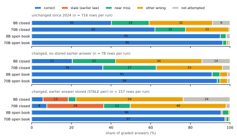

# Technical report — Inkraft

> Three sentence summary: Swiss residents, AHV branch offices, medical practices and social services need exact amounts, deadlines and responsibilities from Swiss social and health insurance law, and a model that states last year's rule is worse than one that says it does not know. Inkraft is a trilingual (German, French, Italian) short-answer benchmark of 327 questions (951 rows) in which every gold answer is backed by a verbatim quote from the authentic text of a federal act as of 1 October 2026, and for 53 amended provisions the previously valid answer is stored verbatim from the earlier Fedlex version, so that wrong answers split into _stale_ (earlier law) and other errors. On release candidate v1.0.0-rc1 (automatically verified; human spot check in progress), Apertus 1.5 70B answers 51 % of rows correctly but only 8 % of the rows whose rule changed with a stored earlier answer, where it gives the earlier law in 29 % of the rows; with the cited paragraph in the prompt it reaches 97 % on the same rows, and a date in the prompt does not help.

**Track:** Apertus Readiness - Track 1B (Swiss Voices, Core Task Intelligence)  
**Event:** Online  
**Team:** Apertool — Niklas Wichter  
**Demo:** project page https://inkraft.apertool.ch; Hugging Face dataset with test items, model responses, judgements and metadata (published with the submission)

---

### Use of Apertus

- **Model:** swiss-ai/Apertus-v1.5-8B and swiss-ai/Apertus-v1.5-70B [@apertus2025; @swissai2026apertus15]
- **How it is used:** evaluation (examinee). Apertus never drafts, fixes or checks items; Apertus-70B is used once as a _comparison_ judge to measure self-preference, never for the reported scores.
- **Where it runs:** hosted Hack Apertus endpoint (OpenAI-compatible); any other endpoint via `LLM_BASE_URL`, `LLM_API_KEY`, `LLM_NAME`

---

## Use Case Description

Every person living in Switzerland is insured under the Federal Health Insurance Act (KVG) and the old-age and survivors' insurance (AHV). Questions about deductibles, contribution rates, waiting periods, family allowances and registration deadlines reach municipal AHV branch offices, front-office staff in medical practices, social services and the insured themselves. Mistakes cost money: a missed switching deadline binds a person to an insurer for another year, a wrong waiting period delays an invalidity insurance (IV) claim. Public administrations already deploy Apertus [@swissai2026apertus15], so the question is not only whether the model knows this law, but whether it knows the law _in force_.

Social insurance law changes on fixed dates. The minimum child allowance under Art. 5 para. 1 FamZG was CHF 200 per month until 2024 and is CHF 215 since the version of 1 January 2025; the deductible for original drugs with cheaper generics (Art. 38a para. 1 KLV) rose from 20 to 40 %. A model trained on older text may give the earlier figure with confidence. Language models have source-specific effective knowledge cutoffs [@cheng2024dateddata], legal hallucinations are frequent [@dahl2024legalfictions], and outdated statutory knowledge has been shown for German law [@prior2026oldfriend]. Inkraft therefore separates three kinds of failure: an answer that matches the rule before an amendment (_stale_), an answer that matches no version (_other_, including near misses), and an honest refusal (_not attempted_).

## Dataset Summary

Inkraft covers 19 federal acts and ordinances on health insurance (KVG, KVV, KLV), old-age, invalidity and supplementary benefits (AHVG, AHVV, IVG, IVV, ELG, ELV), accident insurance and the general part (UVG, ATSG), unemployment and income compensation (AVIG, AVIV, EOG), occupational pensions (BVG, BVV 2, BVV 3), family allowances (FamZG) and continued payment of wages (Art. 324a OR). Each item is a single-turn question with a short gold answer, accepted variants, _near-miss_ answers (a related but wrong value) and, for amended provisions, the outdated answer. Every item is anchored to one paragraph: Fedlex ELI with version date and the verbatim quote in the language of the item. The as-of date is 1 October 2026 for all items.

Table 1 places Inkraft among related benchmarks. SwitzerlandQA [@apertus2025] covers Swiss civics including insurance, but as machine-translated multiple choice without sources. Swiss-Bench SBP-002 and 003 cover FINMA, data protection and contract law [@uenal2026sbp002; @uenal2026sbp003], LEXam covers law exams [@fan2025lexam], and Prior et al. measure outdated knowledge of German statutes [@prior2026oldfriend]. To our knowledge no open benchmark combines Swiss social insurance law, gold answers from three authentic language versions, an as-of date with the verbatim earlier rule, credit for abstention, and an exposure check against the published training data of the evaluated model.

| Benchmark            | Domain, format                   | Stale | Abst. |
| -------------------- | -------------------------------- | ----- | ----- |
| SwitzerlandQA        | civics incl. insurance; MC       | no    | no    |
| Swiss-Bench          | FINMA, nDSG, OR; mixed           | n. r. | n. r. |
| LEXam                | law exams; open + MC             | n. r. | n. r. |
| Prior et al.         | German law; temporal QA          | yes   | n. r. |
| **Inkraft**          | **social insurance; DE/FR/IT**   | **yes** | **yes** |

: Related benchmarks. Stale: separates outdated from wrong answers. Abst.: credits abstention. n. r.: not reported in the abstract (for SwitzerlandQA: Appendix K of the Apertus report).

Release candidate **v1.0.0-rc1** (frozen 2026-10-13, `data/FREEZE.json`) has **327 German core questions, 951 rows**, 312 cores in all three languages. Question types: numeric 114, yes/no 66, procedural 61, temporal 45, calculation 20 (recomputed by the validator from cited inputs), false premise 18, term 3. Registers: professional 170, lay 157. A coverage matrix (domain × question type × change status) is in the data card. The temporal bucket is set per _evidence sentence_ over all stored versions: 248 cores cite a sentence unchanged since 2024, 79 a sentence that changed in 2024–2026; **53 of them are STALE pairs** (157 rows) whose earlier answer occurs verbatim in an earlier Fedlex version and differs from the current one. Drafting models: GPT-5.5 via Codex 98 cores, Claude 97, Gemini 86 (all disclosed per row, see below) and the open model Nemotron 3 Ultra 46 (33 of the 53 STALE pairs).

## Data Collection Method

**Truth comes from the statute, never from a language model.** The pipeline runs Fedlex → paragraphs → version diff → drafting → automatic checks → independent second check → freeze → evaluation → human spot check. It fetches 20 acts and ordinances from the Fedlex SPARQL endpoint (19 are cited by released items; EOV yielded no item that passed the checks) in German, French and Italian: the consolidation applicable on 1 October 2026, the one applicable at the end of 2023, every version in between and published future versions (`src/fetch_fedlex.py`, URLs and SHA-256 in `data/sources/fedlex_manifest.v2.json`). Articles are split into paragraphs; `src/find_changes.py` diffs every paragraph across versions.

**Drafting.** 303 cores were drafted per paragraph by Claude, GPT-5.5 (Codex) and Gemini (an Antigravity agent) in early October; the gold answer must occur verbatim (or as a normalised number) in the paragraph. Because the version diff was the scarce resource, 160 further temporal candidates were drafted by the open model Nemotron 3 Ultra from ranked version diffs (prompt `nemotron-temporal-v2`, hash stored per row), including four found by a numeric diff of acts outside the first manifest (FamZG, EOV, KLV) and checked against the stored Fedlex versions. French and Italian questions are translations, but their gold answers and evidence come from the authentic French and Italian text of the same paragraph, because all three versions are equally binding [@publg2023art14].

**Automatic verification** (`src/validate_items.py`, every row): schema; the evidence occurs verbatim in the cited paragraph of the version valid on the as-of date; the answer occurs in the evidence; the outdated answer occurs verbatim in an earlier stored version and differs from the current value; a near-miss value valid in an earlier version is rejected; calculation items are recomputed from inputs anchored in the cited text; duplicates; language and value consistency across DE/FR/IT; Swiss spelling and a PII scan. **v1.0.0-rc1: 0 errors on 951 rows**, 216 warnings (87 only flag a published later version).

**Release rules** (`src/auto_review.py`, fixed before any model output was scored; decisions logged per core in `data/review/auto/`): existing cores lose paragraph clusters and near-duplicates (19 dropped) and gain machine-proposed answer variants and outdated answers only when the validator passes (21 patched); a candidate needs no validator error, no duplicate and no "reject" in a pre-assessment by claude-opus-5-5 (an agent pass, not a human review), and its correction notes are applied by Nemotron and re-validated (`src/auto_fix.py`). Every remaining core then gets an **independent second check by Qwen3-235B** (`src/second_check.py`, a model family not used for drafting): answer supported by the paragraph, unambiguous question, no leak, equivalent languages, valid variants and near misses, and a real (not merely renamed) earlier rule. 15 of 335 cores were flagged; 8 were dropped, 7 calculation items were kept because the checker sees no calculation inputs while the validator recomputes them. Drop rates by drafting model: Codex 4.9 %, Claude 7.6 %, Gemini 9.5 %, Nemotron 71 % (114 of 160 candidates; most changes in the diff pool are renamings such as "ordentliches Rentenalter" → "Referenzalter").

**Human check.** All rows of rc1 have `status: auto_verified` and `needs_human_review: true`. A stratified random sample of 35 cores (15 of the 53 STALE pairs, 20 of the other 274) is checked by the curator against the linked paragraph, blind to model outputs (`src/make_check_file.py`, seed 20261013); the error rate per stratum with Wilson interval and every rejected core are reported with v1.0.0, and rejected cores are removed without new model calls. No item was selected, changed or removed on model outcomes.

**Exposure check.** Apertus 1.5 was trained on the Swiss legislation subset `switzerland_lexfind` of MultiLegalPile [@swissai2026transparency; @niklaus2024multilegalpile]. For every row we search the verbatim current evidence and, for amended provisions, the earlier evidence in the German, French and Italian files at the published revision of 12 January 2024; we also count 13-gram overlaps between questions and the corpus [@brown2020gpt3; @sainz2023contamination]. On rc1 the current wording occurs in 564 rows, only the earlier wording in 84, neither in 277 (26 evidences too short). For the 135 `temporal` rows the current wording occurs once, the earlier one 76 times. 55 questions share a 13-gram with the corpus; they reuse statutory phrasing, the questions themselves are new.

**Consent.** No personal data is collected; vignettes use roles only. A consent form template for optional reviewers is provided (`docs/consent_form_template.md`).

## Dataset Details

The statute texts are not protected by copyright (Art. 5 para. 1 URG) [@urg2025art5]; Fedlex linked data is offered for free use [@opendataswiss2026terms]. Questions, answers and metadata are released under CDLA-Permissive-2.0; the licence is stored per item. The intermediate MultiLegalPile files (CC BY-NC-SA) are analysed locally and not redistributed. The data card follows the Hack Apertus template, Datasheets and Data Cards [@gebru2021datasheets; @pushkarna2022datacards]; a canary GUID in every file lets model builders exclude the set from training [@srivastava2023bigbench].

## Evaluation

### Method

Grading follows SimpleQA [@wei2024simpleqa]: each answer is CORRECT, INCORRECT or NOT_ATTEMPTED; INCORRECT answers carry the subtype STALE (matches the outdated answer), NEAR_MISS or OTHER. Metrics: correct, incorrect and not-attempted rates, correct given attempted (CGA), F-score, hallucination rate I/(C+I), share of stale errors, penalised scores C − λ·I (λ = 1, 3) [@kalai2025hallucinate; @wen2025abstention], language consistency (same grade in DE, FR and IT) [@qi2023crosslingual] and the open-book gain, which separates a knowledge gap from a reading gap. Intervals are 95 % Wilson or cluster bootstrap over cores (1,000 resamples); paired comparisons use exact McNemar tests.

Grading has three stages. (1) A deterministic pre-grade extracts numbers, number words, units and refusals in all three languages; it is a hint for the judge, never a grade. (2) The LLM judge **Qwen3-235B-A22B-2507** (OpenRouter, temperature 0), a family different from every examinee and every drafting model of the reported items, grades every answer against gold, variants, outdated and near-miss answers [@zheng2023judging; @panickssery2024selfpreference]. On 61 constructed answers with known grades it scores **61/61 on the grade** (gate 0.95) and 57/61 with subtype (four conflicting answers labelled near miss instead of other). (3) A human grades a stratified random 22 % sample of the judgements of the submitted run (Apertus 70B, `closed_dated`: 211 of 951) blind to the judge's grade; raw agreement and Cohen's κ with bootstrap interval are reported with v1.0.0 [@cohen1960kappa; @bavaresco2025llmjudges]. As a diagnostic we also graded the main runs with Apertus-70B as a second judge: judge–judge agreement (Qwen vs Apertus-70B, no human involved) is κ = 0.86 on 70B answers and 0.93 on 8B answers, but Apertus-70B marks 48 more of its own answers correct (533 vs 485, +5.0 points), against +19 on the 8B's answers, a pattern consistent with self-preference; we therefore never use it for scores.

### Evaluation setup and inference parameters

Conditions: `closed_dated` (main): system prompt on Swiss federal law with the date and the instruction to answer briefly and say when unsure; `open_book`: the same plus the cited paragraph; on all 327 German rows also `closed_swiss` (no date) and `closed_plain` (bare question). Parameters: temperature 0, top-p 1, max. 256 output tokens, seed 20261001, reasoning mode off, native chat template of the hosted Hack Apertus endpoint. Runs of 2026-10-13: 5,112 Apertus answers (0 failures after retries), 5,112 judge calls. Paid model use (OpenRouter, as reported per call): judge 0.44 USD, second check 0.06 USD; Nemotron was used free of charge.

### Results

| `closed_dated` | n | 8B | 70B |
| --- | --: | --: | --: |
| All rows | 951 | 32.9 (30–36) | 51.0 (48–54) |
| No earlier answer: correct | 794 | 38.3 (35–42) | 59.6 (56–63) |
| STALE pairs: correct | 157 | 5.7 (3–11) | 7.6 (4–13) |
| STALE pairs: **earlier law** | 157 | 12.7 (8–19) | 28.7 (22–36) |
| STALE pairs, open book | 157 | 95.5 (91–98) | 97.5 (94–99) |
| Corpus has current text | 564 | 41.0 (37–45) | 63.8 (60–68) |
| Corpus has no wording | 277 | 25.6 (21–31) | 38.6 (33–44) |
| Corpus has only earlier | 84 | 7.1 (3–15) | 11.9 (7–21) |
| ... of which earlier law | 84 | 21.4 (14–31) | 34.5 (25–45) |

: Main results on v1.0.0-rc1, % correct unless stated (Wilson 95 % CI), judge Qwen3-235B (`report/analysis.json`). Corpus rows: exposure bucket of the cited wording in MultiLegalPile. Incorrect / not attempted overall: 8B 55.4 / 11.7 %, 70B 47.9 / 1.1 %; F-score 0.35 and 0.51.

{width=100%}

**(1) Apertus knows the old law, not the new one.** On the 157 STALE-pair rows the 70B is correct in 8 % and gives the earlier rule in 29 %, almost four times as often; for 24 of the 53 amended provisions it states the earlier value in at least one language. The 8B answers less (24 % not attempted) and is stale in 13 %. On all 235 rows whose cited sentence changed since 2024 (with or without a stored earlier answer) the 70B is correct in 17.0 % (95 % CI 12.8–22.4) and the 8B in 10.6 % (7.3–15.2); on the other rows the 70B is correct in 60 %. **(2) It is a knowledge gap, not a reading gap.** With the cited paragraph in the prompt the 8B and the 70B answer 94.9 % and 96.3 % of all rows and 95.5 % and 97.5 % of the STALE-pair rows correctly (open-book gain +45 points for the 70B, +62 for the 8B); this also shows that the gold answers are recoverable from the cited text. **(3) Exposure tracks accuracy.** Where only the earlier wording occurs in the published training corpus, the 70B is correct in 12 % and stale in 35 %; where the current wording occurs, it is correct in 64 % (association; bucket, act and change date are confounded). **(4) The date does not help.** On the German rows the date in the system prompt changes the correct rate by −0.3 points for the 70B (11 vs 12 discordant rows, p = 1.0) and by −1.5 for the 8B (p = 0.27); the full system prompt (Swiss law and date) against the bare question adds +1.5 and +1.8 points (p = 0.64, 0.54). **(5) Size helps mostly on stable law.** The 70B is 22 points ahead on unchanged rules (62.2 vs 40.2 %) but only 6 points on changed ones (17.0 vs 10.6 %); overall it beats the 8B on 224 rows and loses on 52 (p < 0.001), consistently in DE (53 %), FR (51 %) and IT (49 %); it gives the same grade in all three languages for 67 % of the cores (8B: 50 %).

## Dataset Limitations

Only federal law; cantonal rules are excluded. v1.0.0-rc1 is verified by deterministic checks against Fedlex and one independent model check, not yet by a full human review; the human spot check covers 35 cores, and the second check flagged little (15 of 335), so it is a weak filter for subtle ambiguity. 281 of 327 cores were drafted by closed models (Claude, GPT-5.5, Gemini), disclosed per row; accuracy by drafting model is reported in `data/results.json`, but drafting model and question type are confounded (all calculation and false-premise items come from Gemini, 33 of 53 STALE pairs from Nemotron). French and Italian questions are model translations; answers come from the authentic texts. One annotator, not a native Swiss speaker. 20 % yes/no items (50 % guessing rate, reported separately). The STALE-pair set (53 cores) is limited by the version diff: most changes since 2024 are renamings or cross-reference renumbering, not new values. The as-of date ages; 29 cores already have a published later version. The exposure check covers only the Swiss legislation subset of MultiLegalPile, not web crawls [@su2025nemotroncc; @penedo2025fineweb2]. Short answers measure knowledge, not the quality of advice.

## Lessons Learnt and Recommendations

For the model: a date in the system prompt does not make Apertus more current, while the cited paragraph fixes almost every error, so the fix has to come from data or retrieval: a refreshed legislation corpus, retrieval with a version filter instead of parametric recall [@prior2026oldfriend], and training abstention instead of rewarding guesses [@kalai2025hallucinate]. For the dataset: yearly updates on 1 January from the version diff, native-speaker review of French and Italian, a cantonal extension. For benchmark builders: the scarce resource is not drafting but real value changes; a paragraph diff over all intermediate versions plus a verbatim check of the earlier answer found 53 usable STALE pairs in 20 acts, and an independent judge family matters, since the examinee as judge was measurably lenient with itself.

## Reproducibility

`make run` builds a Docker image (Python 3.12, no GPU, no API keys) and replays the scoring offline: it recomputes all eight result blocks from the stored responses (`data/responses/`) and judgements (`data/judgements/`) and compares them with `data/expected_results.json` (PASS/FAIL). `make run MODE=full` evaluates any OpenAI-compatible model given `LLM_*` and grades with `JUDGE_*` (smoke test: `LIMIT=50`). `scripts/run_after_freeze.sh` reruns calibration, generation, judging, scoring and the human sample page; `report/analysis.py` and `report/make_figures.py` recompute every number and the figure in this report. The dataset construction is scripted end to end (`src/fetch_fedlex.py` → `find_changes.py` → `gen_nemotron.py` → `validate_items.py` → `auto_fix.py` → `auto_review.py` → `second_check.py` → `after_review.py` → `freeze.py`). Seeds: 20261001 (generation), 20261016 (bootstrap), 20261013 (human samples). `make test` runs the unit tests.

## License

This report and the documentation: CC-BY-4.0. Code: Apache-2.0. Dataset (questions, answers, metadata): CDLA-Permissive-2.0, licence stored per item in `metadata.jsonl`. Statute quotes: not protected by copyright (Art. 5 URG). The judge prompt adapts the SimpleQA grader of OpenAI simple-evals (MIT).

## References
